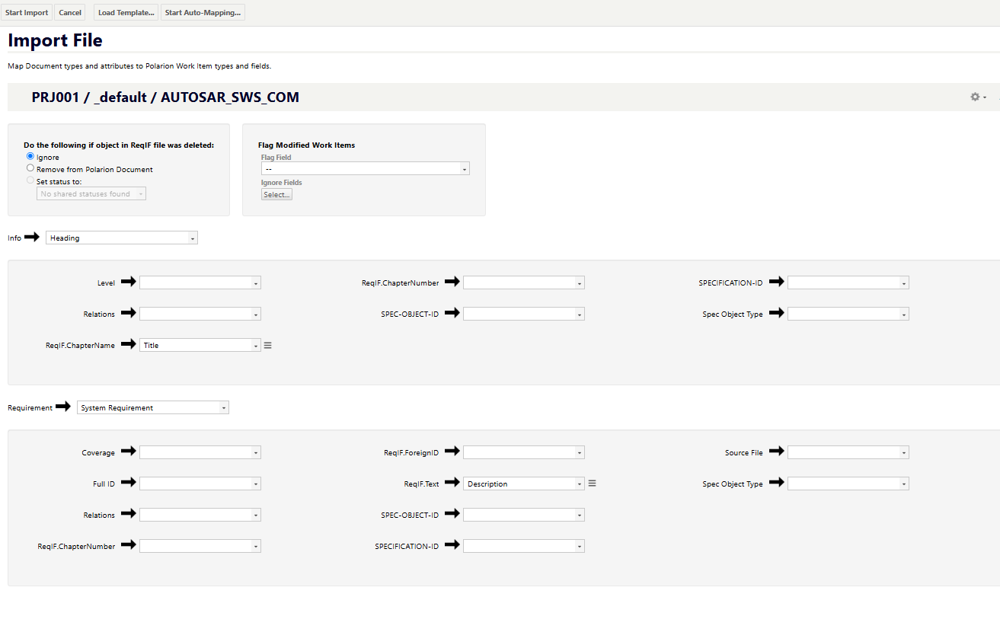
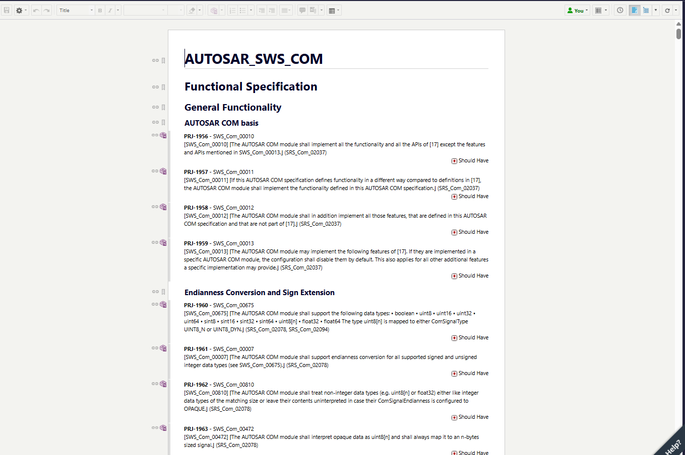
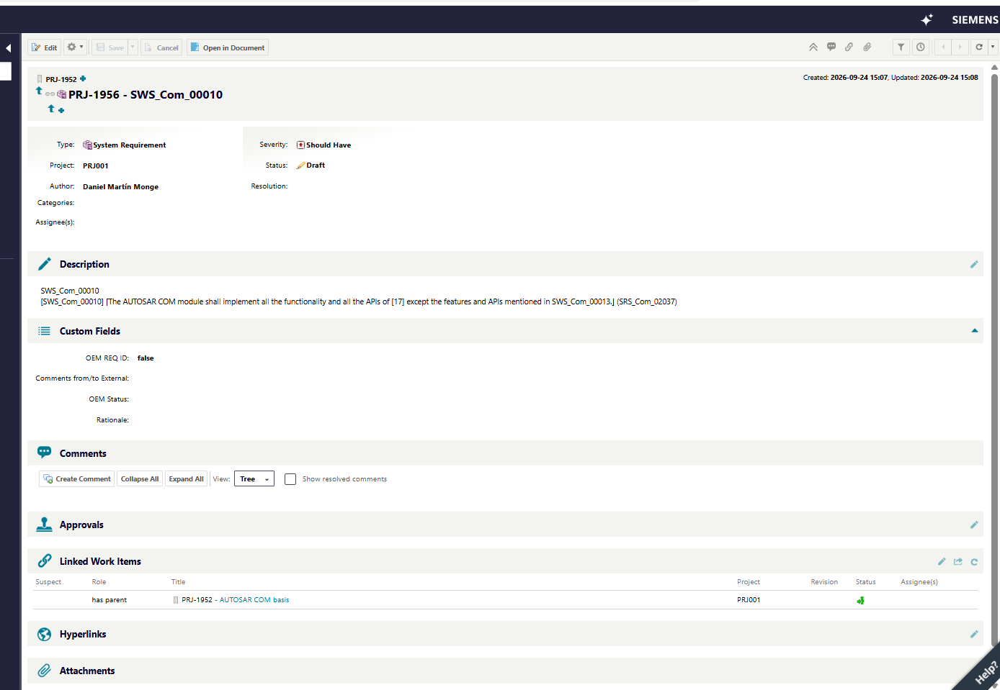

# reqif-extractor · PDF → ReqIF for Polarion

*Read this in [Español](README.es.md).*

Turns a specification PDF into a ReqIF file that imports into Polarion with the document's own hierarchy, its identifiers taken verbatim, and every item in the position it had on the page. The model reads; the code decides what an identifier is, what is informative, and in which order things go. No data in this repository.

> AI carries risk. Code bounds it. The standard answers for what remains.

[Design philosophy](#design-philosophy) · [Why AI here](#why-ai-here) · [The five steps](#the-five-steps-in-this-project) · [Measured](#measured) · [Public documents](#public-documents) · [Demo](#demo-in-four-commands-public-data) · [Limitations](#limitations) · [Security & regulation](#security--regulation)

---

## Design philosophy

Every AI application has five steps. Only step 4 invokes a model; the other four are code: reproducible, testable, offline. Step 5 never patches: it flags and degrades. Full text at [epifaneia.dev](https://epifaneia.dev).

```
 1 CLEANING      2 CONTEXT       3 INPUT GUARDRAIL   4 PROCESS        5 OUTPUT GUARDRAIL
 ■ code          ■ code          ■ code              ▲ model          ■ code
```

## Why AI here

Any assistant can read a specification PDF and list its requirements as text. What none of them can do credibly is hand you the file Polarion accepts: identifiers taken verbatim, the document's hierarchy, items in page order, one XHTML root per value, every reference resolved. That is where the value is, and it is the pair that produces it: the model finds the items in any layout, in paragraphs, table rows or figures, and the output guardrail turns that list into a ReqIF that imports. A list in a notebook is a starting point. A file that imports on the first attempt is the deliverable.

---

## The five steps in this project

★ marks where the improvement lives in this project: the **output guardrail**. The model classifies well; what it cannot be trusted with is inventing identifiers, dropping the "information only" marker, or reordering. Three deterministic guards fix exactly those three things.

| Step | What it does here | |
|---|---|---|
| 1 · Cleaning | `s1` runs docling once: PDF → markdown, plus the layout's own regions (figures and tables, with page and bounding box). Tables are rebuilt from the vector text with gmft, no vision. Figures are cropped. Anything the layout did not see is caught by an orphan check: an id-shaped string in the text that nothing captured sends that document to a full-page fallback. | |
| 2 · Context | `s2` parses headers deterministically from the markdown (number, level, anchor). The model will receive the document already structured, and will attach every item to a header anchor instead of describing where it is. | |
| 3 · Input guardrail | On the main route every first attempt carries a response schema: `s3` extraction and header audit; `s4` tables, row sweep, orphan rescue and figure crops. `type` is an enum `{requirement, information}`; `parent_header ∈ known anchors` is checked by code after the call. A `type` outside the enum is kept as `requirement`, flagged `type_coerced` and counted in the run summary, never fixed silently. `s4` asks for table rows as sentences and forbids the model, in the schema and in the prompt, to fill an identifier the row does not literally carry: an empty string is the correct answer. Without a schema: the retry after a non-JSON answer (`s4` tables on the 2nd attempt, crops on the 3rd) and the whole-page fallback `s4_legacy_fullpage`, which only asks for JSON. Step 5 applies to all of them. | |
| 4 · Process | Pass A: one text call per document on the markdown. Pass B: routed by region, tables as text and figures as image crops in batches, `gemini` or a local VLM under the same contract. Measured on 9 documents (~600 pages): pass B cost $0.43, where whole-PDF vision cost ~1 € per 100 pages, and kept 98.4 % of that baseline's items. | |
| 5 · Output guardrail | `utils/id_policy`: an identifier is accepted only if it is **verbatim** in the document; otherwise it is **derived** from the table's own id and the row (`SWS_Com_00347.3`), or **anchored to the page** (`TBL-P31.4`) in a form that cannot be confused with a real one, or **rejected** and reported. `s5c_infoguard` reconciles `type` against the source's own "(information only)" marker. `s5b_positions` audits order and hierarchy against the PDF. `s5_merge` dedups by id, deterministic. `s6` builds the ReqIF from a Polarion template with one `<xhtml:div>` root per value and every reference resolved. | ★ |

## Measured

The numbers in this table come from runs on real specification documents of one manufacturer (confidential, not included; processed in the cloud with the client's authorisation). The last column says which run each one comes from. The figures measured on public documents are in the next section, counted from the output files.

| What | Number | Where it comes from |
|---|---|---|
| Identifiers the model invented on the table route, before the policy | **167 of 170** rows | One real document with 170 table rows, recorded in `utils/id_policy.py` when it was measured; no results file. The model numbered rows mimicking the document's convention, colliding with real ids (`…-7` vs `…-007`) |
| Identifiers that changed between two runs on the same PDF, before the policy | **49 of 214** | Same document and same record. Not reproducible. After the policy: 0 |
| Cost of pass B with region routing, 9-document batch (~600 pages) | **$0.43** | Whole-PDF vision was ~1 € per 100 pages, ~6 € for those pages (different currencies, so no exact ratio is claimed) |
| Items kept by region routing against the whole-PDF vision baseline | **98.4 %** (1,194 of 1,214) | Compared id by id; the 20 missing (1.65 %) were audited one by one: arbiter discards in three documents |
| Documents passing the five structural checks against a Polarion-imported reference | **12 / 12**, 2,695 references resolved, 0 orphans | Measured on the previous engine (v4) with Python and lxml over the real files (private report, 12 June 2026). On the current engine: 12 documents × 2 modes, XML valid and references resolved. Checks: XML well-formed, spec types identical, one div root, references resolved, per-document id prefix |

## Public documents

Run on 24 September 2026. Counted from the output `.reqif` files; every identifier checked by code against the PDF's text.

| Document | Pages | Requirements | Headings | Identifiers |
|---|---|---|---|---|
| AUTOSAR Specification of Communication (SWS COM), Classic Platform R21-11 | 220 | **465** | **217** | 465 of 465 copied verbatim from the PDF (351 `SWS_Com_…`, 114 `ECUC_Com_…`); none derived or page-anchored |
| NIST SP 800-171 Rev. 2 (public domain; withdrawn on 14 May 2024 and superseded by Rev. 3) | 114 | **382** | **18** | 382 of 382 copied verbatim from the PDF |

## Polarion

The AUTOSAR file, imported into a Polarion trial. The import was done by hand; these screenshots are its record. Nothing to redact.

*The import mapping: headings to Heading, items to System Requirement, `ReqIF.ChapterName` (heading title) to Title, `ReqIF.Text` to Description. `ReqIF.ForeignID` carries the verbatim id in the file but was left unmapped in this trial.*



*The document after import: the PDF's own hierarchy, every item under its heading, every title the verbatim `SWS_Com_…` identifier.*



*One requirement: identifier, text, and its parent heading as a link. `OEM REQ ID: false` is a custom field of the trial project, not a value from the file: with `ReqIF.ForeignID` unmapped it keeps its default. Map `ReqIF.ForeignID` to that field to fill it.*



## Demo in four commands (public data)

AUTOSAR specifications are public and use exactly the pattern this engine was built for: identifiers in brackets at the end of each item. NIST SP 800-171 is public domain.

```bash
pip install -r requirements.txt              # full pipeline, pinned (pulls torch); tests and tools need only requirements-core.txt
cp .env.example .env                         # GEMINI_API_KEY (required); REQIF_VLM_BACKEND=local keeps figure crops local
# drop AUTOSAR_SWS_COM.pdf (autosar.org) and NIST_SP_800-171r2.pdf (nist.gov) in data/inputs/
python run.py                                # s1 → s6, all documents, in parallel
python tools/crop_ids.py && python tools/sanitize_reqif.py     # Polarion-ready variants
```

Output, all under `data/outputs/reqif/`:

- `s6`: `v1_nested/<doc>.reqif` (recommended) and `v2_flat/<doc>.reqif` with `BUILD_MODE=both`, the default; with `nested` or `flat` it writes straight into `data/outputs/reqif/`.
- `tools/crop_ids.py`: copies to `<mode>_shortid/` with instance ids cut to the document code (`SWSCOM_SO-R-0001`), so a Polarion length limit cannot truncate them into collisions; references rewritten.
- `tools/sanitize_reqif.py`: copies `<mode>_shortid/` to `<mode>_shortid_clean/`, removing control and invisible characters, odd spaces and stray HTML tags from values, never from identifiers. The file to import is `v1_nested_shortid_clean/<doc>.reqif`.

This repository ships no data; `data/` is ignored by git.

## Limitations

- `id_policy` is slightly weaker than "verbatim or nothing" in two cases, found by the tests: an id with the derived shape (`….N`) passes on shape alone on the crop, rescue and fallback routes (the table route is safe: it ignores ids the model returns), and "verbatim" is a substring test, so a truncated prefix of a real id is accepted. Fixing both needs re-measuring on the real corpus.
- Items of `type=information` are still emitted as requirement work items, explicitly marked `(information only)` in the visible text. Mapping them to Polarion's native Info type is pending.
- The vision pass still has noise: a false positive with a new id enters the file. `id_policy` rejects the invented ones; it cannot reject a real-looking one that is simply wrong.
- **The engine always needs the cloud today.** Pass A (document markdown), table rows and orphan arbitration go to Gemini whatever the backend. The local VLM replaces only one call, the figure crops of pass B:

  | | Cloud (`gemini`) | Local VLM (`vlm_local`) |
  |---|---|---|
  | What it covers | Everything: markdown, table rows, figure crops, arbitration | Figure crops only |
  | Where the data goes | Leaves the machine | Crops stay on the machine; the text still leaves |
  | Hardware | None | A GPU that fits the model |
  | Cost | Per token; pass B measured at $0.43 for ~600 pages after region routing (whole-PDF vision: ~1 € per 100 pages) | Electricity |
  | Switch | Default | `REQIF_VLM_BACKEND=local` |

  So the engine is for **public or non-confidential specifications**, or confidential ones only when their owner authorises sending them to the cloud, as the client did for the 12 documents above. A fully local route (pass A and tables through a local model) is not built.
- `reference/gold.reqif`, a file that imported correctly into Polarion, is optional and not included: it depends on your project's template.
- Identity, events and sign-off are shipped as a contract with a local default (environment variable, JSONL file, HMAC key). The adapters to a company's Entra ID, SIEM or PKI are not here and cannot be tested here: see [docs/INTEGRATION.md](docs/INTEGRATION.md).

---

## Security & regulation

Same four headings in every repository. Rows marked **today** are what the code does. Rows marked **wire** are the three integration wires the repository ships as a contract (identity, events, sign-off) and the company connects to its own systems: see [docs/INTEGRATION.md](docs/INTEGRATION.md). Local tests, no network and no key: `python tests/todas.py` (custody wires, identifier policy, s3/s6/tools on synthetic data; needs only `requirements-core.txt`).

| | | |
|---|---|---|
| **Confidentiality** | This engine sends document text to a cloud model (`GEMINI_MODEL`), so it is for **non-confidential specifications**, or confidential ones whose owner authorises cloud processing. What leaves: the markdown of the document in pass A, table rows as text in pass B, and figure crops unless `REQIF_VLM_BACKEND=local`, which keeps only the crops on the machine. `.env` and `data/` are outside git. | **today** |
| | A fully local route (pass A and tables through a local model), then local by default with cloud as the exception that has to be switched on. Not done yet: today the cloud is required, and the ledger records every call that leaves. | **next** |
| **Traceability** | Every item carries its origin: page, header anchor, source of the id (verbatim, derived, page-anchored), and the reconciliation flips of `infoguard` are reported per document. `s5b_positions` writes an audit of order and hierarchy against the PDF. Identifiers are never contaminated by markers or prefixes: the `(information only)` marker goes only in the visible text, `AD-FullID` / `AD-ReqID` stay clean for the tools that match on them downstream. | **today** |
| | **Wire 2 · events.** Every model call goes through `custodia/ledger`: one JSON line with actor, step, engine, endpoint, whether data left the machine, input size and hash. Never the text. `logs/custody.jsonl` or stdout. The company points its SIEM at it. | **wire** |
| **Leak prevention** | The model holds no credentials; the client holds the endpoint and the key comes from the environment or a git-ignored `.env`, never from the repository. Only `clients/gemini` and `clients/vlm_local` send document content over the network, and both go through the ledger. Everything else is code that sends nothing. | **today** |
| | **Wire 1 · identity.** `run.py` refuses to start without a named actor (`custodia/identity`, default `CUSTODIA_ACTOR`); the actor is stamped on every event and every signature. The company replaces the provider with Entra ID, LDAP, Kerberos or its SSO in one call. Per-layer permissions on inputs, intermediates, model and outputs are the company's, on its file system and its vault. | **wire** |
| **Human in the loop** | Rejected identifiers and reconciliation flips are reported, never silently applied. The nested variant is the only one recommended for import; the flat one is opt-in with its risks written down. | **today** |
| | **Wire 3 · sign-off.** An output is a proposal until `tools/signoff.py sign` writes its manifest (file hash, actor, timestamp, signature) and `verify` passes; a changed file or a wrong key fails. Nothing the model touched is imported without a manifest that verifies. The company replaces the local HMAC key with its PKI or its Polarion approval workflow by registering two functions. | **wire** |

Written with reference to the EU AI Act (2024/1689), GDPR, ISO/IEC 42001, ISO/IEC 27001 and TISAX. No certification or conformity is claimed: the table says which part the code covers and which part belongs to the company.

---

## Structure

```
pipeline/    s1..s6 (+ s5b positions, s5c infoguard, s4_legacy_fullpage fallback)
clients/     gemini · vlm_local · docling_adapter        templates/  polarion_template.reqif
prompts/     requirements_extraction.txt · rescue_audit.txt
tools/       crop_ids · sanitize_reqif · survey_regions · verify_positions · signoff
utils/       id_policy · orphans · ids · md_headers · json_helpers
custodia/    identity · ledger · signoff · cli  — the three integration wires
tests/       todas (runner) · test_custodia · test_id_policy · test_salida — offline, synthetic data
docs/        ARCHITECTURE_v5.md · PLAN_robust.md · RISK_polarion.md · INTEGRATION.md
data/        inputs · interim · outputs — all outside git
```

Daniel Martín · [epifaneia.dev](https://epifaneia.dev) · Apache-2.0
